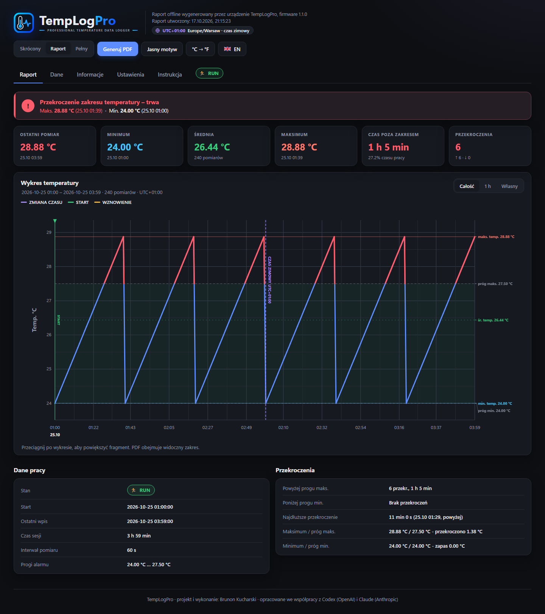
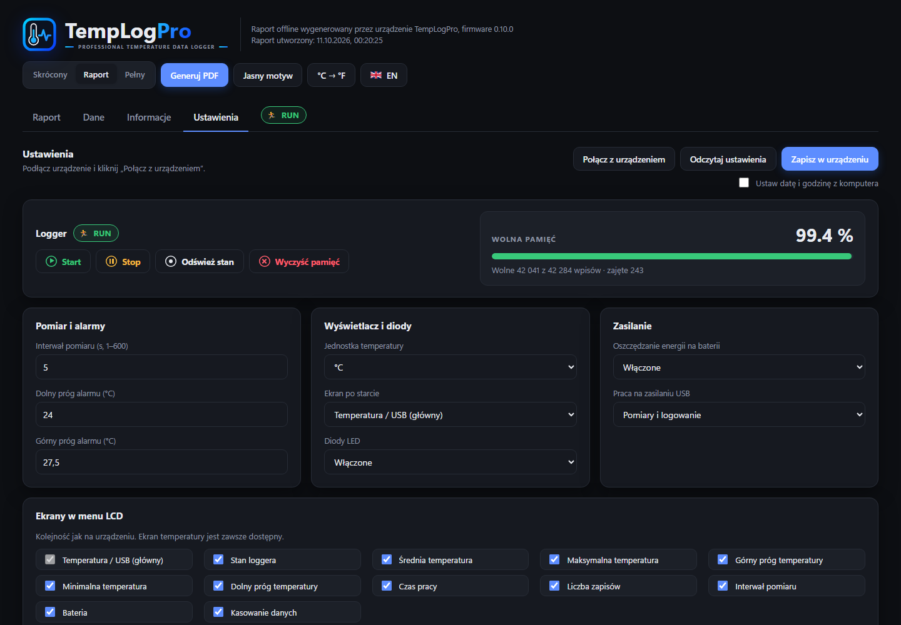

<p align="center"></p>

<h1 align="center">TempLogPro</h1>
<p align="center"><b>Professional temperature data logger</b> — otwarte firmware dla rejestratora na sprzęcie TempTale Ultra (STM32L152)</p>

<p align="center"></p>

TempLogPro zastępuje oryginalne oprogramowanie rejestratora temperatury
własnym firmware: mierzy i zapisuje temperaturę, pilnuje progów alarmu,
pokazuje wartości na oryginalnym segmentowym LCD, pracuje miesiącami na
baterii, a po podłączeniu USB udostępnia raport HTML działający całkowicie
offline — z wykresem, analizą przekroczeń, eksportem do PDF i ustawieniami
urządzenia przez Web Serial.

Autor: **Brunon Kucharski** · opracowane we współpracy z **Codex (OpenAI)** i **Claude (Anthropic)**
Wersja firmware: **0.10.0** · licencja **MIT**

## Funkcje

- pomiar co 1–600 s, do **42 284 wpisów** w pamięci Winbond, zapis odporny na reset i utratę zasilania;
- dwa progi alarmu, wykrywanie przekroczeń i powrotu do zakresu;
- oryginalny LCD: 12 konfigurowalnych ekranów, °C/°F, serce i zielona dioda jako heartbeat, X i czerwona dioda przy alarmie;
- przyciski START/STOP z odliczaniem i anulowaniem, kasowanie logu z menu;
- tryb STOP na baterii (~16 µA w spoczynku);
- USB: dysk `TEMPLOGPRO` z plikami `TempLogPro.html`, `DATA.CSV`, `README.TXT`, `POWER.TXT` oraz port szeregowy do konfiguracji;
- raport HTML offline (Chrome/Edge): werdykt, kafelki, wykres z zakresami i strefami „brak danych”, tabele, filtr pomiarów, CSV, PL/EN, motyw jasny/ciemny;
- PDF: skrócony, standardowy i pełny, z własnym nagłówkiem, numeracją stron i polami „Uwagi / Sprawdził”.

<p align="center"></p>

## Wgranie gotowego firmware

1. Podłącz ST-Link do złącza SWD **J2** na płytce (SWDIO, SWCLK, GND, 3,3 V, NRST; zdjęcie i opis w [docs/HARDWARE.md](docs/HARDWARE.md)).
2. W STM32CubeProgrammer wgraj `firmware/TempLogPro.bin` pod adres `0x08000000`
   (tryb połączenia *Under reset*, bez *Full chip erase*).
3. Po restarcie podłącz USB — pojawi się dysk `TEMPLOGPRO`; otwórz `TempLogPro.html` w Chrome lub Edge.

> Wgranie TempLogPro trwale zastępuje oryginalne oprogramowanie rejestratora.

## Budowanie ze źródeł

Wymagane: STM32CubeIDE 2.2.0 w `C:\ST\STM32CubeIDE_2.2.0` (kompilator,
make, STM32CubeProgrammer), ST-Link, Python 3, Node.js i Microsoft Edge.

```powershell
powershell -ExecutionPolicy Bypass -File tools\build_release.ps1   # build -> Release\TempLogPro.bin
powershell -ExecutionPolicy Bypass -File tools\flash_release.ps1   # wgranie (pamięć danych nie jest kasowana)
pip install -r tests\requirements.txt                              # emulator do testów
Get-ChildItem tests\*.py | % { python $_.FullName }               # testy firmware
node tests\panel_edge_vectors.cjs                                  # test panelu HTML
```

Testy obrazów diagnostycznych (`tests/module_probe_*.py`) wymagają wcześniej
`tools\build_module_probe.ps1`. Projekt można też otworzyć w STM32CubeIDE
(File → Import → Existing Projects into Workspace).

Panel HTML edytuje się w `panel/templogpro.html`; build sam generuje z niego
`Src/templogpro_panel_html.inc`. Wersja, nazwa produktu i autor są w
`Inc/templogpro_version.h`.

## Struktura

| Folder | Zawartość |
| --- | --- |
| `Src/`, `Inc/` | firmware (aplikacja, logger, sterowniki, USB) |
| `panel/` | źródło raportu/panelu HTML |
| `firmware/` | gotowy obraz do wgrania |
| `tools/` | build, wgrywanie, generator panelu, obrazy diagnostyczne |
| `tests/` | testy automatyczne (emulacja Cortex-M3, panel w Edge) |
| `diagnostics/` | firmware diagnostyczne do badania sprzętu |
| `docs/` | notatki techniczne z etapów projektu |
| `Drivers/`, `Startup/` | biblioteki i pliki startowe STMicroelectronics |

- **[Instrukcja obsługi](docs/INSTRUKCJA.md)** — przyciski, ekrany, raport, PDF, rozwiązywanie problemów
- **[Sprzęt i podłączenie ST-Linka](docs/HARDWARE.md)** — złącze SWD, zdjęcie płytki, pinout procesora
- **[Dokumentacja i raport z projektu](DOKUMENTACJA.md)** — pełny opis techniczny

## Podziękowania i źródła

- Mapa pamięci LCD szkła TempTale Ultra (`temptale-ultra_LCD.pdf`) pochodzi
  z projektu [TempTale Ultra teardown & repurpose](https://hackaday.io/project/189442-temptale-ultra-teardown-repurpose)
  na Hackaday.io — dziękujemy autorowi za rozpracowanie szkła LCD.
- Rozpoznanie płytki i złącza SWD oraz zdjęcie w [docs/HARDWARE.md](docs/HARDWARE.md):
  [Free ARM Development Board From a Used-up Temperature Logger](https://www.instructables.com/Free-ARM-Development-Board-From-a-Used-up-Temperat/) (Instructables).
- Biblioteki STM32 HAL, USB Device i CMSIS: STMicroelectronics / Arm, na ich własnych licencjach.

## Zastrzeżenie

Projekt jest niezależny i nie jest powiązany z firmą Sensitech ani
producentem urządzeń TempTale. „TempTale” jest znakiem towarowym jego
właściciela i występuje tu wyłącznie jako opis sprzętu. Używasz na własną
odpowiedzialność; urządzenie nie jest certyfikowanym rejestratorem do
zastosowań regulowanych.

---

## English summary

**TempLogPro** is open-source firmware for temperature data loggers built on
TempTale Ultra hardware (STM32L152, segment LCD, Winbond flash, CR3450
battery, USB). It logs up to 42,284 entries with power-loss-safe storage,
handles high/low alarms, drives the original LCD, runs for months on battery,
and exposes an offline HTML report (`TempLogPro.html`) with charts, excursion
analysis, CSV and PDF export, and device settings over Web Serial.
Flash `firmware/TempLogPro.bin` at `0x08000000` with STM32CubeProgrammer, or
build with `tools/build_release.ps1`. Full documentation (Polish):
[DOKUMENTACJA.md](DOKUMENTACJA.md). Author: Brunon Kucharski, developed in
collaboration with OpenAI Codex and Anthropic Claude. MIT licensed;
third-party components keep their own licenses. Not affiliated with Sensitech.
