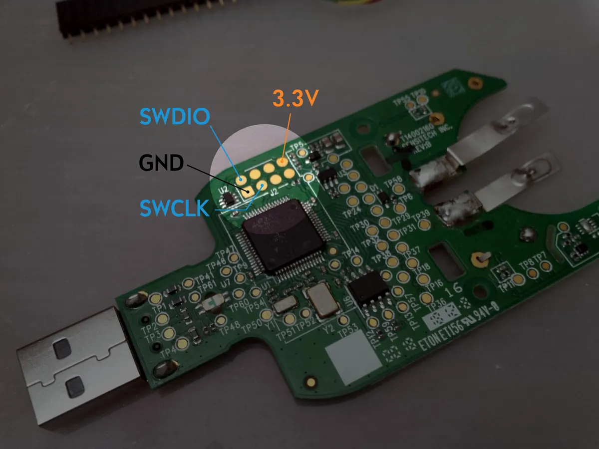

# TempLogPro — sprzęt, podłączenie ST-Linka i pinout

[README](../README.md) · [Instrukcja obsługi](INSTRUKCJA.md) · [Dokumentacja techniczna](../DOKUMENTACJA.md)

TempLogPro działa na płytce rejestratora **TempTale Ultra** (Sensitech).
Ten dokument pokazuje, gdzie podłączyć programator i jak są połączone
elementy płytki z mikrokontrolerem.

---

## 1. Płytka i złącze programowania

*Zdjęcie: [Free ARM Development Board From a Used-up Temperature Logger](https://www.instructables.com/Free-ARM-Development-Board-From-a-Used-up-Temperat/)
(Instructables) — prawa do zdjęcia należą do jego autora; użyte z podaniem źródła.*

Programowanie odbywa się przez **SWD** na padach złącza **J2**, tuż obok
procesora (lewy górny róg płytki, przy oznaczeniu U2):

| Pad J2 | Sygnał | ST-Link | Pin MCU (LQFP64) |
| --- | --- | --- | --- |
| SWDIO | PA13 | SWDIO | 46 |
| SWCLK | PA14 | SWCLK | 49 |
| GND | masa | GND | 12, 18, 31, 47, 63 |
| 3.3V | zasilanie / pomiar napięcia | 3.3V lub VAPP / T_VCC | 13, 19, 32, 48, 64 |
| NRST (opcjonalnie) | reset | NRST | 7 |

### Podłączenie krok po kroku

1. Otwórz obudowę i wyjmij płytkę. Wyjmij baterię albo pamiętaj, że będzie
   zasilała układ równolegle z ST-Linkiem.
2. Przylutuj cienkie przewody (albo listwę goldpin) do padów **SWDIO, SWCLK,
   GND i 3.3V**. Jeśli masz możliwość, podłącz też **NRST** procesora — wtedy
   tryb *Under reset* działa najpewniej.
3. Połącz przewody z ST-Linkiem według tabeli.
4. W STM32CubeProgrammer wybierz **ST-LINK**, port **SWD**, tryb **Under reset**
   (tryb *Hot plug* na tej płytce nie działa), kliknij **Connect**.
5. Przy pierwszym wgraniu oryginalne oprogramowanie jest kasowane; wgraj
   `firmware/TempLogPro.bin` pod adres `0x08000000` z weryfikacją.
6. Później wgrywaj aktualizacje **bez** opcji *Full chip erase* i bez zmiany
   *Option Bytes* — pamięć pomiarów (zewnętrzny Winbond) nie jest wtedy ruszana.

Z terminala zamiast GUI: `tools\flash_release.ps1` (patrz README).

> Jeśli ST-Link nie widzi procesora, najpierw sprawdź zasilanie (napięcie
> pokazywane przez ST-Link ~3,3 V), przewody SWD i NRST. Brak połączenia nie
> oznacza uszkodzenia firmware.

---

## 2. Elementy płytki

| Element | Układ / oznaczenie | Uwagi |
| --- | --- | --- |
| Mikrokontroler | STM32L152RC (STM32L1, Cortex-M3, 256 KiB Flash, 32 KiB RAM), obudowa LQFP64 | device ID `0x427` |
| Pamięć danych | Winbond W25X40, 4 Mbit (512 KiB), SPI, układ 8-nóżkowy obok procesora | JEDEC `EF 30 13` |
| Czujnik temperatury | I2C, adres `0x48`, zgodny z TMP102/TMP112 | dokładny model niepotwierdzony |
| Wyświetlacz | segmentowy LCD TempTale Ultra, 4 COM, 1/4 duty | mapa segmentów: [Hackaday.io](https://hackaday.io/project/189442-temptale-ultra-teardown-repurpose) |
| Przyciski | START, STOP | aktywne stanem niskim |
| Diody | zielona, czerwona | |
| USB | wtyczka USB-A wbudowana w płytkę | Full Speed, Mass Storage + CDC |
| Zasilanie | bateria CR3450 (blaszki po prawej stronie) lub USB | |
| Rezonatory | Y1, Y2 przy procesorze | USB korzysta z HSE 8 MHz przez PLL; RTC pracuje na wewnętrznym LSI (drugi rezonator, prawdopodobnie 32,768 kHz, nie jest używany) |

---

## 3. Pinout mikrokontrolera

Połączenia potwierdzone diagnostyką i używane przez firmware. Numery nóżek
według noty katalogowej ST dla obudowy **LQFP64**.

| Pin MCU | Port | Funkcja w TempLogPro | Kierunek |
| --- | --- | --- | --- |
| 7 | NRST | reset (SWD) | we |
| 8 | PC0 | dioda zielona | wy |
| 14 | PA0 | przycisk START (aktywny niski) | we |
| 15 | PA1 | przycisk STOP (aktywny niski) | we |
| 20 | PA4 | Winbond CS (SPI1) | wy |
| 21 | PA5 | Winbond SCK (SPI1) | wy |
| 22 | PA6 | Winbond MISO (SPI1) | we |
| 23 | PA7 | Winbond MOSI (SPI1) | wy |
| 44 | PA11 | USB D− (także wykrywanie kabla) | we/wy |
| 45 | PA12 | USB D+ (także wykrywanie kabla) | we/wy |
| 46 | PA13 | SWDIO | we/wy |
| 49 | PA14 | SWCLK | we |
| 58 | PB6 | czujnik I2C SCL (programowe I2C) | wy |
| 59 | PB7 | czujnik I2C SDA (programowe I2C) | we/wy |
| 61 | PB8 | dioda czerwona | wy |
| 1 | VLCD | zasilanie LCD | — |
| pozostałe linie LCD | PA/PB/PC (funkcja AF11) | COM0–COM3 i segmenty wyświetlacza | wy |

Uwagi:

- Wykrywanie kabla USB odbywa się na liniach D+/D−; płytka nie ma osobnego
  pinu VBUS.
- Firmware włącza funkcję LCD (AF11) na wszystkich pinach niezajętych przez
  powyższe sygnały, dlatego dokładne przypisanie segmentów LCD do konkretnych
  nóżek nie jest zmapowane. Segmenty są adresowane przez pamięć RAM
  kontrolera LCD zgodnie z mapą z Hackaday.
- Punkty testowe TPxx na płytce nie są jeszcze opisane.
- Szczegóły badań: [module_probe_findings_2026-09-19.md](module_probe_findings_2026-09-19.md),
  [winbond_jedec_pinout_report.md](winbond_jedec_pinout_report.md).

---

## 4. Źródła

- [Free ARM Development Board From a Used-up Temperature Logger](https://www.instructables.com/Free-ARM-Development-Board-From-a-Used-up-Temperat/) — Instructables: rozpoznanie płytki i złącza SWD, zdjęcie powyżej.
- [TempTale Ultra teardown & repurpose](https://hackaday.io/project/189442-temptale-ultra-teardown-repurpose) — Hackaday.io: mapa pamięci LCD (`temptale-ultra_LCD.pdf`).
- STMicroelectronics: nota katalogowa STM32L151xC/STM32L152xC (pinout LQFP64).
