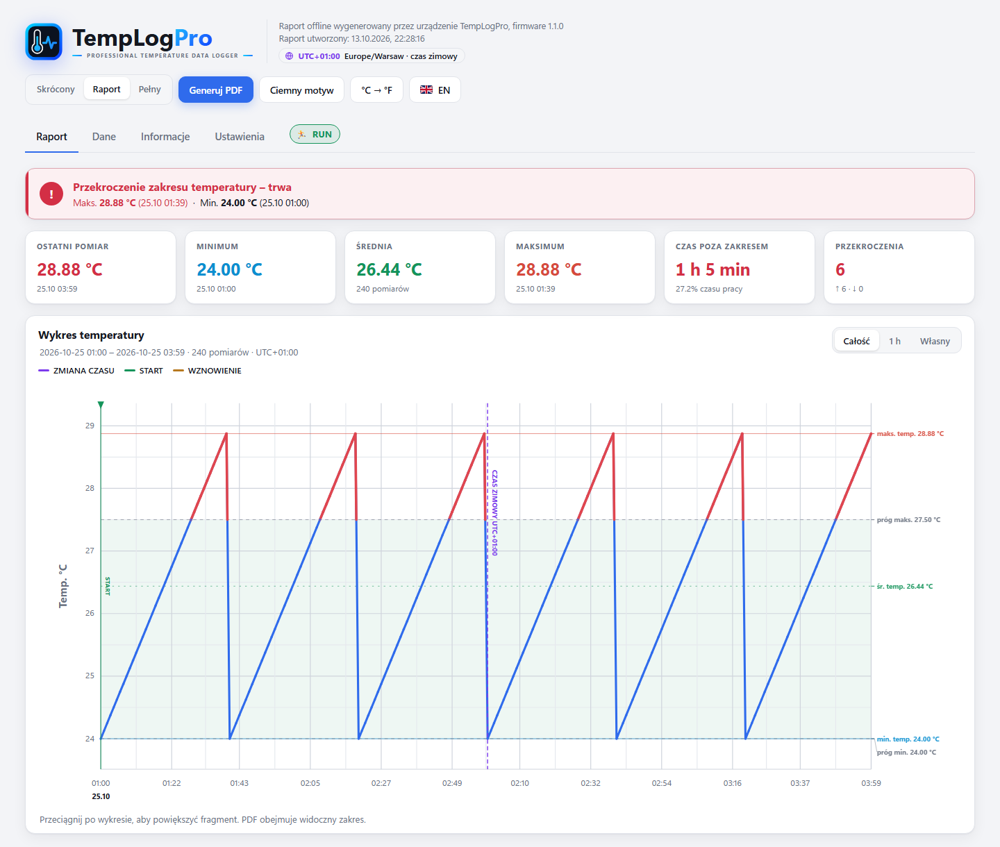
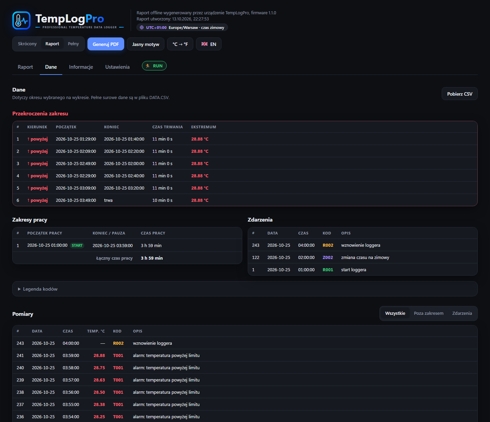
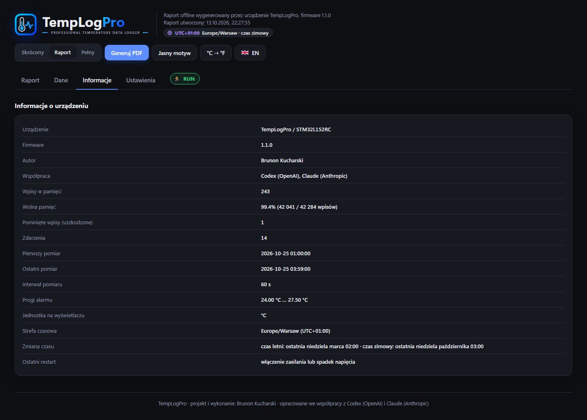

# TempLogPro — instrukcja obsługi

Firmware 1.1.0 · [README](../README.md) · [Dokumentacja techniczna](../DOKUMENTACJA.md) · [Sprzęt i podłączenie ST-Linka](HARDWARE.md)

TempLogPro to rejestrator temperatury: mierzy temperaturę w stałych odstępach,
zapisuje pomiary w pamięci, ostrzega o przekroczeniu ustawionego zakresu,
a po podłączeniu do komputera tworzy raport z wykresem i PDF.

---

## 1. Wyświetlacz i przyciski

Urządzenie ma segmentowy wyświetlacz i dwa przyciski: **START** i **STOP**.

| Co robisz | Co się dzieje |
| --- | --- |
| krótko **START** | poprzedni ekran |
| krótko **STOP** | następny ekran |
| przytrzymaj **START** 3 s | rozpoczęcie albo wznowienie zapisu |
| przytrzymaj **STOP** 3 s | pauza zapisu |
| na ekranie **CLR** przytrzymaj **oba** przyciski 3 s | wyczyszczenie pamięci pomiarów |

Po przytrzymaniu przez 3 s na wyświetlaczu pojawia się odliczanie od 5 do 0
(`r 5…r 0` przy starcie, `S 5…S 0` przy pauzie, `C 5…C 0` przy czyszczeniu).
Trzymaj przycisk do końca odliczania. **Puszczenie przycisku w dowolnym
momencie odliczania anuluje akcję** — nic się nie zmienia.

Po 10 sekundach bez naciskania wyświetlacz wraca do ekranu temperatury. Na
baterii cyfry gasną, żeby oszczędzać energię; zostają ikony stanu. Naciśnij
dowolny przycisk, aby je przywrócić.

### Ekrany

Kolejność na urządzeniu (niektóre można ukryć w ustawieniach):

1. **Temperatura** — ostatni pomiar (po podłączeniu USB napis `USB`)
2. **Zegar** — godzina w formacie 12 h, np. `9:41` (ikona TIME, dwukropek miga co sekundę;
   ikona słońca świeci od 12:00 do 23:59, czyli po południu)
3. **Stan** — `rdY` gotowy, `run` zapis trwa, `StP` pauza
4. **Średnia** (ikona AVG)
5. **Maksimum** (MAX)
6. **Próg górny** (PROBE + MAX)
7. **Minimum** (MIN)
8. **Próg dolny** (PROBE + MIN)
9. **Czas pracy** (klepsydra + jednostka: sekundy, minuty, godziny, dni)
10. **Liczba zapisów** (PROBE)
11. **Interwał pomiaru** w sekundach (PROBE + TIME)
12. **Bateria** w procentach (szacunkowo; przy USB napis `USB`)
13. **CLR** — czyszczenie pamięci

### Znaczki i diody

| Sygnał | Znaczenie |
| --- | --- |
| ✔ (ptaszek) | wszystko w porządku, brak alarmu |
| ♥ (serce) + zielona dioda | właśnie zapisano pomiar (mignięcie przy każdym pomiarze) |
| ✖ (krzyżyk) świecący | w bieżącym zapisie było przekroczenie zakresu |
| czerwona dioda, dwa błyski co 3 s | alarm |
| strzałka ↑ / ↓ | kierunek przekroczenia (za ciepło / za zimno) |
| znak STOP | zapis jest zatrzymany |

Alarm (krzyżyk, strzałka, czerwona dioda) zostaje widoczny do wyczyszczenia
pamięci — także wtedy, gdy temperatura wróciła już do zakresu. Dzięki temu
widać, że przekroczenie się zdarzyło.

---

## 2. Pierwsze uruchomienie

1. Podłącz rejestrator do komputera kablem USB (wbudowana wtyczka).
2. Pojawi się dysk **TEMPLOGPRO**. Otwórz plik **`TempLogPro.html`** w
   przeglądarce **Chrome** lub **Edge**.
3. Przejdź do zakładki **Ustawienia** i kliknij **Połącz z urządzeniem**
   (wybierz port TempLogPro / „USB Serial Device”).
4. Ustaw interwał pomiaru, progi alarmu, jednostkę i pozostałe opcje.
5. W grupie **Czas i strefa czasowa** kliknij **Wstaw czas i strefę z komputera**
   (zaznacza też „Ustaw zegar przy zapisie”), potem **Zapisz w urządzeniu**.
   Pod spodem pojawi się **Zegar urządzenia** z informacją, czy zgadza się z komputerem.
6. W karcie **Logger** kliknij **Start** albo odłącz urządzenie i przytrzymaj
   **START** przez 3 s.

Zegar urządzenia warto ustawiać z komputera przy każdym nowym zapisie, bo
wewnętrzny zegar może się z czasem spieszyć lub spóźniać.

---

## 3. Ustawienia

| Ustawienie | Opis |
| --- | --- |
| Interwał pomiaru | co ile sekund zapisywać pomiar (1–600 s) |
| Dolny / górny próg alarmu | dozwolony zakres temperatury (°C) |
| Jednostka temperatury | °C lub °F na wyświetlaczu (raport ma osobny przełącznik) |
| Ekran po starcie | który ekran pokazać po włączeniu |
| Diody LED | włączone / wyłączone (wyłączenie oszczędza baterię) |
| Strefa czasowa | strefa, w której pokazywany jest czas (np. Europe/Warsaw) |
| Zmiana czasu | automatycznie wg strefy, ręcznie (własne dni przejścia na czas letni i zimowy) albo bez zmiany |
| Data i godzina | ręczne ustawienie zegara w czasie lokalnym wybranej strefy |
| Ustaw zegar przy zapisie | zaznaczone: **Zapisz w urządzeniu** ustawia też zegar — z komputera albo z pola „Data i godzina” |
| Zegar urządzenia | po połączeniu widać zegar procesora na żywo (24 h) i różnicę względem komputera |
| Oszczędzanie energii na baterii | zalecane włączone |
| Praca na zasilaniu USB | *Pomiary i logowanie* albo *Tylko raporty i ustawienia* (wtedy przy USB zapis jest wstrzymany) |
| Ekrany w menu LCD | które ekrany są dostępne przyciskami |

*Zakładka **Ustawienia**: u góry przyciski połączenia i zapisu, karta Logger
(Start, Stop, Odśwież stan, Wyczyść pamięć) z paskiem wolnej pamięci, niżej
grupy Pomiar i alarmy, Wyświetlacz i diody, Zasilanie, Czas i strefa czasowa
(strefa, zmiana czasu, zegar, „Wstaw czas i strefę z komputera”) oraz wybór
ekranów LCD w kolejności takiej jak na urządzeniu.*

Ustawienia są zapisywane w urządzeniu dopiero po kliknięciu **Zapisz w
urządzeniu**. Przycisk **Odczytaj ustawienia** pobiera aktualne wartości.

---

## 4. Raport

Plik `TempLogPro.html` zawsze pokazuje aktualne dane z urządzenia. Działa bez
internetu. Można go też skopiować na komputer — będzie zawierał dane z chwili
skopiowania.

*Zakładka **Raport** (motyw ciemny). Od góry: logo, wersja firmware, data
raportu i znaczek strefy czasowej; przyciski rodzaju PDF, motywu, jednostki
i języka; werdykt (tu czerwony — trwa przekroczenie); kafelki z ostatnim
pomiarem, minimum, średnią, maksimum, czasem poza zakresem i liczbą
przekroczeń; wykres z progami (przerywane linie), zakresem dozwolonym
(zaciemnione pole), odcinkami poza zakresem na czerwono i fioletową linią
zmiany czasu; na dole dane pracy i podsumowanie przekroczeń.*

*Ten sam raport w jasnym motywie (przycisk **Jasny motyw / Ciemny motyw**).
PDF zawsze drukuje się na jasnym tle.*

- **Raport** — od razu widać, czy temperatura była w zakresie (zielony pasek)
  czy nie (czerwony, z maksimum i minimum). Pod nim kafelki, wykres i dane
  pracy. Zakres wykresu zmieniasz przyciskami **Całość / 1 h / 24 h / 7 dni /
  Własny** albo przeciągając myszą po wykresie.
- **Dane** — lista przekroczeń (kiedy, jak długo, ile stopni), zakresy pracy,
  zdarzenia i wszystkie pomiary (z filtrem i stronami). **Pobierz CSV** zapisuje
  dane do Excela.
- **Informacje** — dane urządzenia i pamięci, strefa czasowa i przyczyna
  ostatniego restartu.
- Znaczek strefy (np. **UTC+02:00 Europe/Warsaw · czas letni**) pokazuje, w jakiej
  strefie są godziny w raporcie. Fioletowa linia **CZAS LETNI / CZAS ZIMOWY**
  na wykresie oznacza zmianę czasu.
- Szare pole **BRAK DANYCH** na wykresie oznacza przerwę w zapisie, np. gdy
  urządzenie było wyłączone albo zmieniono zegar.

### PDF

1. Wybierz rodzaj: **Skrócony** (1 strona), **Raport** (2 strony) albo
   **Pełny** (ze wszystkimi pomiarami).
2. Kliknij **Generuj PDF**.
3. Wpisz ewentualne **Uwagi** i **Sprawdził** (imię i nazwisko) — pojawią się
   tylko w PDF. Puste pola zostaną do wypełnienia ręcznie.
4. W oknie drukowania wybierz **Zapisz jako PDF**.

PDF obejmuje zakres widoczny na wykresie.

### Zakładka Dane

*Zakładka **Dane**: tabela przekroczeń (kierunek ↑/↓, początek, koniec, czas
trwania, ekstremum; „trwa” = przekroczenie jeszcze się nie skończyło),
zakresy pracy z łącznym czasem, zdarzenia z kodami (`R001` start, `R002`
wznowienie, `Z002` zmiana czasu na zimowy), rozwijana legenda kodów i lista
pomiarów z filtrem **Wszystkie / Poza zakresem / Zdarzenia**. Wartości poza
zakresem są czerwone, kod `T001` oznacza alarm górny.*

### Zakładka Informacje

*Zakładka **Informacje**: model i wersja firmware, autor, liczba wpisów
i wolna pamięć, pominięte (uszkodzone) wpisy, pierwszy i ostatni pomiar,
interwał, progi, jednostka LCD, strefa czasowa z regułą zmiany czasu oraz
**Ostatni restart**. Jeśli restart nastąpił w trakcie CLR/START z powodu
słabej baterii, wiersz jest czerwony: „spadek zasilania podczas CLR —
prawdopodobnie słaba bateria”.*

---

## 5. Pamięć

Pamięć mieści **42 284 wpisy** (np. przy pomiarze co 5 minut — ponad 140 dni).
Wolne miejsce widać w zakładce **Ustawienia** (karta Logger) i **Informacje**.
Gdy pamięć się zapełni, zapis się zatrzymuje.

Czyszczenie: przycisk **Wyczyść pamięć** w panelu (z potwierdzeniem) albo
ekran **CLR** i oba przyciski przez 3 s. Przed czyszczeniem zapisz raport lub
`DATA.CSV`, jeśli dane są potrzebne.

---

## 6. Zasilanie

- Rejestrator pracuje na baterii **CR3450** (3 V); w spoczynku pobiera ok.
  16 µA, więc bateria wystarcza na długo.
- Po podłączeniu USB urządzenie zasila się z komputera i może dalej mierzyć
  (zależnie od ustawienia „Praca na zasilaniu USB”).
- Ekran **Bateria** pokazuje przybliżony stan na podstawie napięcia.
- Przed **CLR** i **START** na baterii urządzenie sprawdza napięcie. Poniżej
  2,7 V odmawia: przez 3 s migają ikona baterii i X, a stan się nie zmienia —
  kasowanie pamięci przy słabej baterii mogłoby zrestartować urządzenie.
  Wymień baterię albo podłącz USB.
- Jeśli mimo to bateria „siądzie” w trakcie CLR/START, po ponownym starcie
  przez 5 s miga ikona baterii, a przyczyna jest w `POWER.TXT`
  (`LAST_RESET`) i w raporcie (Informacje → Ostatni restart).

> Znany problem: przy podłączonym USB bateria jest obciążana i jej napięcie
> spada. Do czasu wyjaśnienia nie zostawiaj urządzenia długo podłączonego do
> USB z włożoną baterią.

---

## 7. Rozwiązywanie problemów

| Problem | Co zrobić |
| --- | --- |
| Nie widać dysku po podłączeniu | odłącz i podłącz ponownie; sprawdź inny port USB |
| „Połącz z urządzeniem” nie działa | użyj Chrome lub Edge; zamknij inne programy korzystające z portu COM; odśwież stronę |
| Start z panelu odrzucony (`E007`) | w Ustawieniach ustaw *Praca na zasilaniu USB: Pomiary i logowanie* albo odłącz USB i wystartuj przyciskiem |
| Na wyświetlaczu `Err` | odłącz i podłącz zasilanie; jeśli wraca — zgłoś problem, nie czyść pamięci przed zrobieniem kopii |
| Zła data w raporcie | Ustawienia → **Wstaw czas i strefę z komputera** → **Zapisz w urządzeniu** |
| Zmiana czasu w złym dniu | Ustawienia → Zmiana czasu: **Ręcznie** i ustaw dni przejścia |
| Krzyżyk miga, choć temperatura jest dobra | to pamiątka po wcześniejszym przekroczeniu; zniknie po wyczyszczeniu pamięci |
| Windows pokazuje starą nazwę pliku | odłącz i podłącz USB |
| Po CLR/START migają bateria i X, nic się nie dzieje | za słaba bateria (poniżej 2,7 V) — wymień ją lub podłącz USB |
| Urządzenie samo się zrestartowało | sprawdź Informacje → Ostatni restart albo `LAST_RESET` w `POWER.TXT` |

---

TempLogPro · autor: Brunon Kucharski · opracowane we współpracy z Codex (OpenAI) i Claude (Anthropic)
